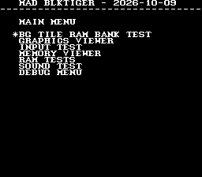
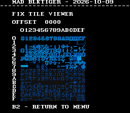
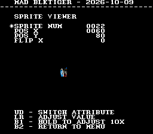
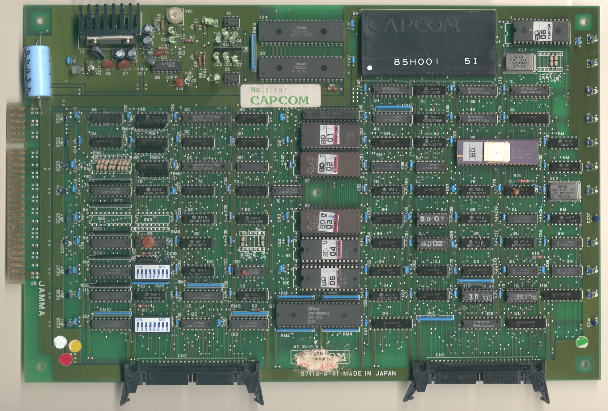
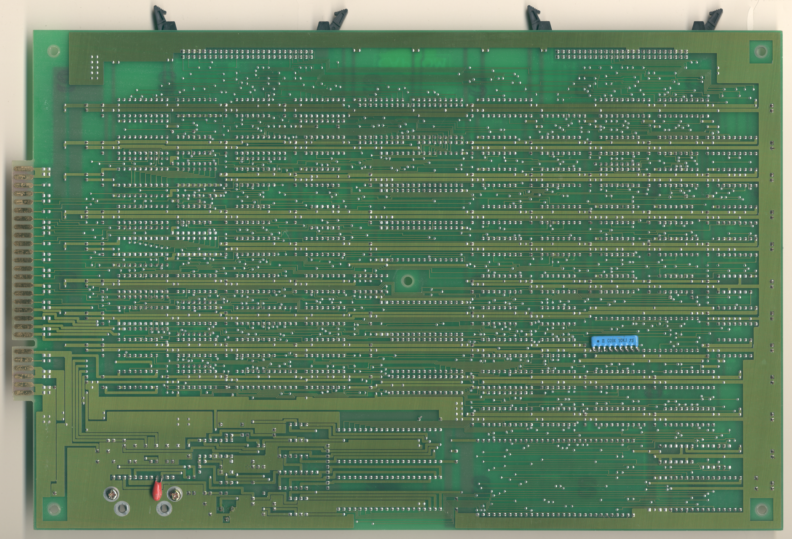
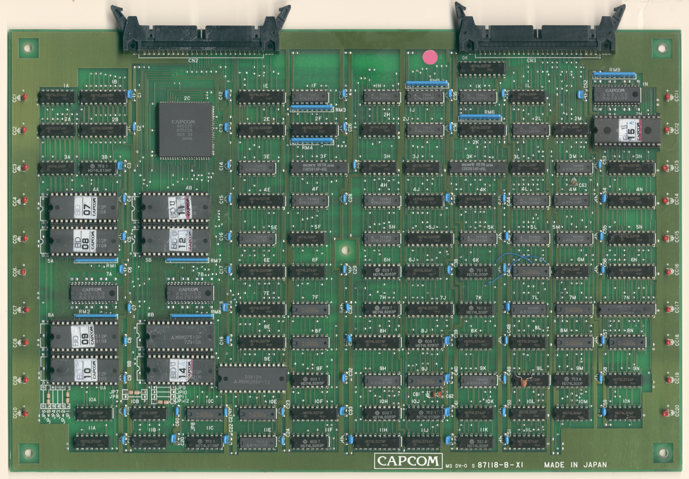
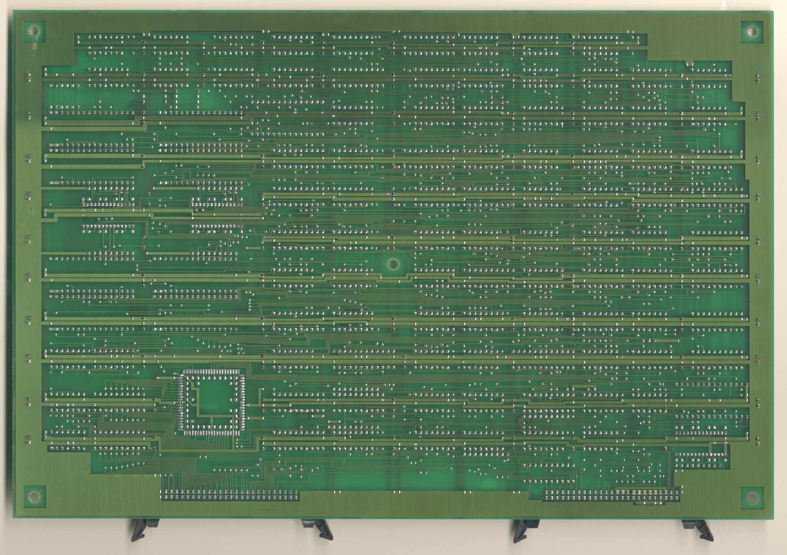

# Black Tiger
- [MAD Pictures](#mad-pictures)
- [PCB Pictures](#pcb-pictures)
- [Manual / Schematics](#manual-schematics)
- [MAD Eproms](#mad-eproms)
- [RAM Locations](#ram-locations)
- [Errors/Error Codes](#errorserror-codes)
  - [Main CPU](#main-cpu)
  - [Sound CPU](#sound-cpu)
- [MAD Notes](#mad-notes)
  - [Blue text while redrawing screen](#blue-text-while-redrawing-screen)
  - [No Video DAC Test](#no-video-dac-test)
- [MAME vs Hardware](#mame-vs-hardware)

## MAD Pictures

 

## PCB Pictures

The CPU and Graphics PCB have their solder sides facing each other.

## Manual / Schematics
[Manual](docs/black_tiger_manual.pdf) 

Schematics don't seem to exist.

## MAD Eproms

| Diag | Eprom Type | Location | Notes |
| ---- | ---------- | ----------- | ----- |
| Main | 27c256 | bdu-01a.5e @ 5E | |
| Sound | 27c256 | 4K | No MAD ROM exists yet |

## RAM Locations
| RAM | Location | Type |
| -------- | :------- | ----- |
| BG Tile RAM | 9E on Graphics Board | M5M5256P-12 (32k x 8bit) |
| Sound RAM | Inside 85H001 on CPU Board | ??? (2k x 8bit) |
| Tile RAM | 7N on Graphics Board | D4364CX-15 (8k x 8bit) |
| Work/Sprite RAM | 4E on CPU Board | D4364CX-15 (8k x 8bit) |

There are 2x CXK5814P-45L @ 4C/6C (2k x 8bit) RAM chips on the CPU board which 
are used for palette RAM.  The CPU is only allowed to write to this RAM so there
is no way to test it.

There are 2x CXK5814P-45L @ 3F/3K (2k x 8bit) RAM chips on the graphics board
which are not accessible by the CPU.  They are likely related to line buffering.

## Errors/Error Codes
MAD for the main CPU is expecting the game's original sound rom to be there
in order to play sounds, including making beep codes.

### Main CPU
The main CPU is a Z80.  If an error is encountered during tests, MAD will print
the error to the screen, play the beep code, then jump to the error address

On Z80's the error address is `$6000 | error_code << 7`.  Error codes on the
Z80 CPU are are 6 bits.

<!-- ec_table_main_start -->
| Hex  | Number | Beep Code |     Error Address (A15..A0)    |           Error Text           |
| ---: | -----: | --------: | :----------------------------: | :----------------------------- |
| 0x01 |      1 | 0000 0001 |      0110 0000 1xxx xxxx       | BG TILE RAM ADDRESS            |
| 0x02 |      2 | 0000 0010 |      0110 0001 0xxx xxxx       | BG TILE RAM DATA               |
| 0x03 |      3 | 0000 0011 |      0110 0001 1xxx xxxx       | BG TILE RAM MARCH              |
| 0x04 |      4 | 0000 0100 |      0110 0010 0xxx xxxx       | BG TILE RAM OUTPUT             |
| 0x05 |      5 | 0000 0101 |      0110 0010 1xxx xxxx       | BG TILE RAM WRITE              |
| 0x06 |      6 | 0000 0110 |      0110 0011 0xxx xxxx       | FIX TILE RAM ADDRESS           |
| 0x07 |      7 | 0000 0111 |      0110 0011 1xxx xxxx       | FIX TILE RAM DATA              |
| 0x08 |      8 | 0000 1000 |      0110 0100 0xxx xxxx       | FIX TILE RAM MARCH             |
| 0x09 |      9 | 0000 1001 |      0110 0100 1xxx xxxx       | FIX TILE RAM OUTPUT            |
| 0x0a |     10 | 0000 1010 |      0110 0101 0xxx xxxx       | FIX TILE RAM WRITE             |
| 0x0b |     11 | 0000 1011 |      0110 0101 1xxx xxxx       | WORK RAM ADDRESS               |
| 0x0c |     12 | 0000 1100 |      0110 0110 0xxx xxxx       | WORK RAM DATA                  |
| 0x0d |     13 | 0000 1101 |      0110 0110 1xxx xxxx       | WORK RAM MARCH                 |
| 0x0e |     14 | 0000 1110 |      0110 0111 0xxx xxxx       | WORK RAM OUTPUT                |
| 0x0f |     15 | 0000 1111 |      0110 0111 1xxx xxxx       | WORK RAM WRITE                 |
| 0x3e |     62 | 0011 1110 |      0111 1111 0xxx xxxx       | MAD ROM ADDRESS                |
| 0x3f |     63 | 0011 1111 |      0111 1111 1xxx xxxx       | MAD ROM CRC32                  |

Table last updated by gen-error-codes-markdown-table on 2026-10-13 @ 01:41 UTC
<!-- ec_table_main_end -->

### Sound CPU
The sound CPU is a z80.  No MAD rom exists yet for the sound CPU.

## MAD Notes
### Blue text while redrawing screen
When redrawing the screen MAD will clear out palette ram, then re-init the white
color in to for text.  The memory layout of palette ram is a bit weird in that
$d800 to $dbff are red/green bits, and $dc00 to $dfff are blue.  This causes
text to be temporary blue since red/green get cleared first.

### No Video DAC Test
It should be possible to make one, but will be a pita to do.  Fix tile only has
3 colors per palette and there are only 3 solid blocks.

## MAME vs Hardware
MAME >= 0.289 is required.
